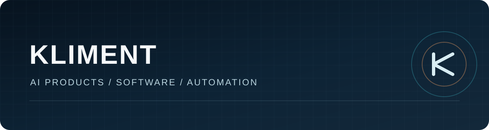

# Hi, I'm Kliment

I build software and AI products for real work and business. I work with models, automation, developer tools and generative media, turning ideas into usable products and workflows.

## Projects

- **OLA Cy** — a product for Cyprus.
- **[TaleMondo Studio](https://github.com/Klimentios/talemondo-studio)** — my noncommercial AI filmmaking Studio for MiniMax H3. Its agents help plan scenes, assign references, direct shots, prepare GPU jobs, review takes and assemble an edit.
- **[NEONEXUS](https://github.com/Klimentios/neonexus)** — an open-source workspace for AI agents and human-reviewed code.

I also work on infrastructure and other products. This profile will grow with the projects I publish.

## Field notes

- [MiniMax H3: reference video, character identity, and render cost](./writing/minimax-h3-field-notes.md) — observations from my own production workflow, with measured limits.
- [Inside TaleMondo Studio](./writing/talemondo-studio.md) — the public code, production workflow, credits and seven video examples.

## Connect

[Reddit](https://www.reddit.com/user/Due_Investigator1455/) · [Hugging Face](https://huggingface.co/klimentioss)
