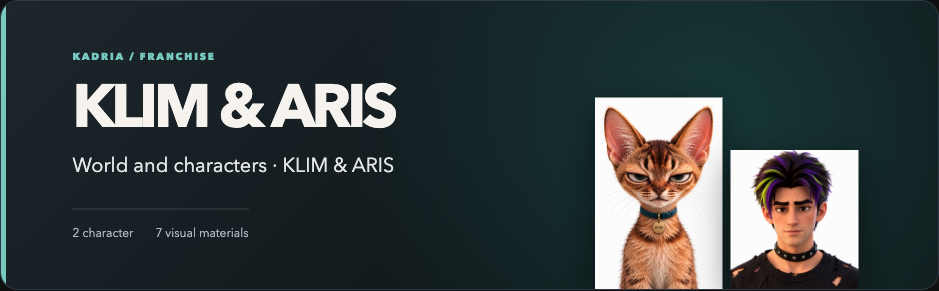
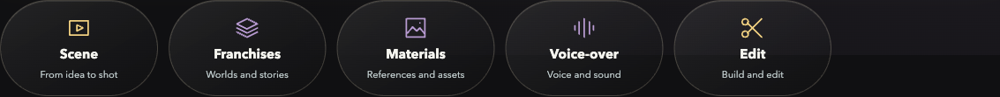
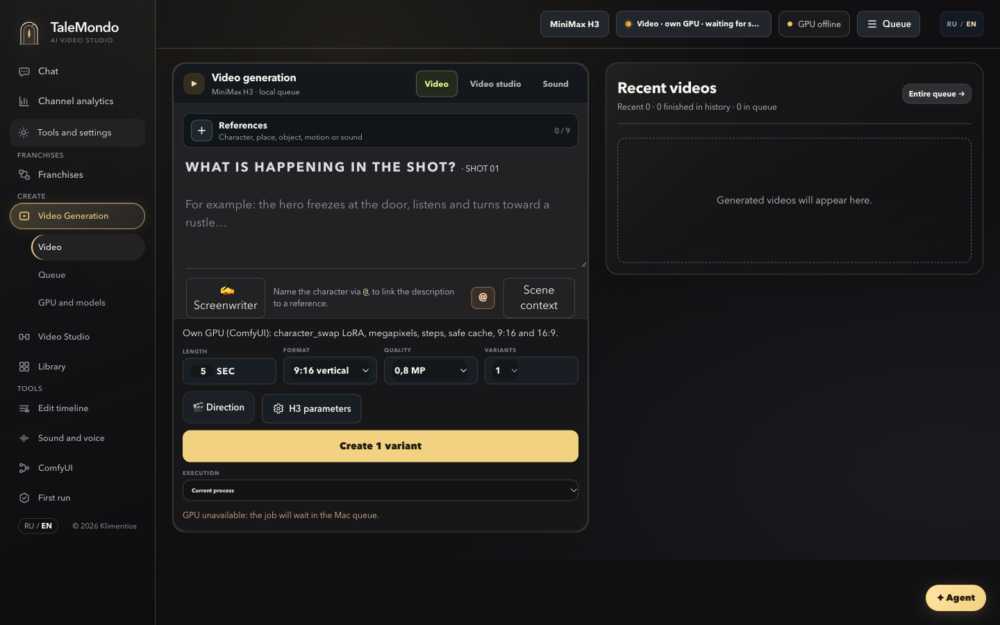
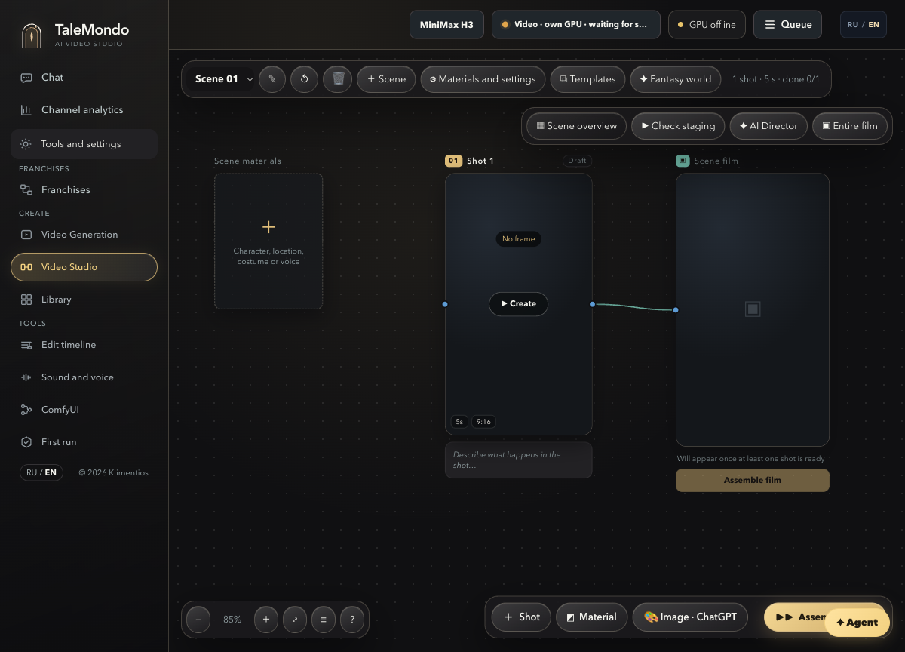
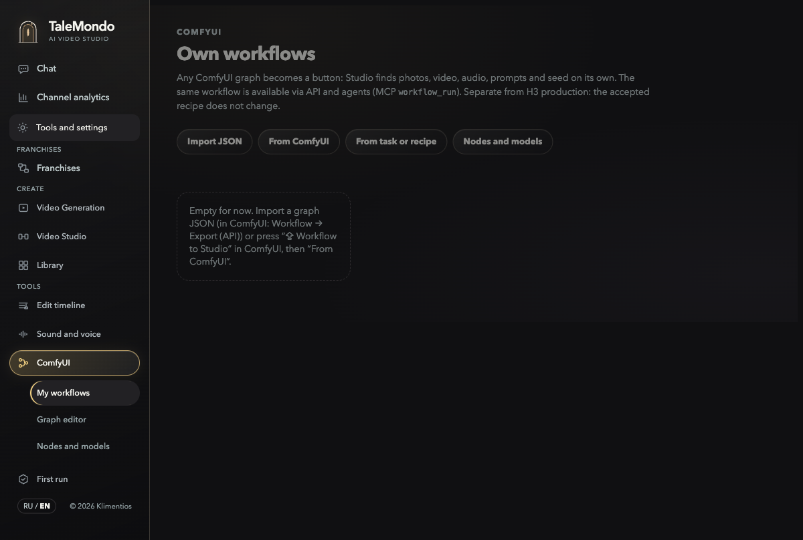

# TaleMondo Studio for MiniMax H3: direct a scene, guide an agent, finish a film

*A public, noncommercial edition of my local AI video production studio. Published 8 November 2026.*

[**Explore the source and installation guide**](https://github.com/Klimentios/talemondo-studio) · [**Watch the 25-second interface tour**](media/talemondo/studio-interface-tour.mp4) · [**Jump to seven video examples**](#video-gallery) · [Read my MiniMax H3 field study](minimax-h3-field-notes.md)

I built TaleMondo Studio as a production system for my MiniMax H3 work. I can start with an idea in chat or work directly in the interface. The Studio keeps a franchise world, character and location references, scene and shot plans, camera direction, H3 jobs, take reviews and editing in the same project. Its agent tools can carry out the preparation steps with me: read the existing material, draft a scene, connect references to shots, check staging, prepare generation, follow the queue and help assemble a cut. I decide when the story is ready, when GPU work is authorized and which take is accepted.

This is the distinctive part of the product: the agent works inside the same production context as the creator, instead of receiving a disconnected prompt for each clip. The [public repository](https://github.com/Klimentios/talemondo-studio) contains the Mac application, GPU-side code, ComfyUI integration, MCP server and setup scripts. The documented H3 generation path uses ComfyUI on a connected NVIDIA GPU.

[](https://github.com/Klimentios/talemondo-studio)

*A character project in my working Studio. Its private board notes and source files are outside the image.*

## What the Studio can do with me

A creator can give the Studio agent a franchise and an idea. Its production playbooks expose a concrete sequence: find the idea and related images; build a package of characters, places, look and mode; draft and approve the story; stage heroes and camera on a floor plan; draft the scene; check shots; place the result on the canvas; and, when authorized, submit H3 work to the GPU queue. For an existing scene, the agent can read its board, resolve reference assets, validate a production spec, check staging, inspect job receipts and move into review and editing. These are [real MCP playbooks and tools](https://github.com/Klimentios/talemondo-studio/blob/main/scripts/h3_studio_mcp.py), not a promise that every idea automatically becomes a finished film.

**Direction is more than a free-text prompt.** Studio offers named presets for shot size and angle, lens look, camera movement, focus, light, colour, visual style and acting. The creator can set scene defaults and override them shot by shot. The Studio compiles these choices into the job request and checks the graph's capabilities before queueing. Camera-brand choices describe an intended image character; they do not turn H3 into a physical ARRI or Sony camera. The [preset catalog](https://github.com/Klimentios/talemondo-studio/blob/main/preview/h3-director/director-presets.mjs) and [shot compiler](https://github.com/Klimentios/talemondo-studio/blob/main/preview/h3-director/scene-queue.mjs) show the implementation.

## The production path

1. **Collect the inputs.** The asset library keeps photos, video and audio with roles such as full character, face, costume, environment, motion, camera and scene guide. A shot can refer to these assets by numbered tags. The distinction matters: a source clip that should supply motion for a world change must not silently become the visual world to preserve.
2. **Build a scene.** Story workspaces hold scenes, shots, reference assignments and keyframes. The creator can plan which character appears in each shot, where the camera is, what action occurs, and how cuts and continuity work. World and character profiles are *user-created data*, not bundled franchises in the public repository.
3. **Prepare and render.** Studio compiles the shot into an H3 job, checks the input and required ComfyUI capabilities, then places it in a local queue. The Mac UI and project data stay local; a connected NVIDIA GPU server runs ComfyUI and H3. A completed queue entry is a saved output, not automatic approval of its visual or audio quality.
4. **Review and edit.** Takes remain attached to their jobs and source settings. The creator can compare, accept or reject them, assemble a scene and work with the montage and export tools. Some editor integrations have separate compatibility limits documented in the repository; I do not treat the presence of an export button as proof of a finished film.

**Queue and review are separate steps.** Studio checks a job before sending it, records it in the queue, and keeps the resulting MP4 and job settings available for take review. A completed status means the file arrived; it does not approve the acting, identity, timing or audio. The creator can inspect the take before accepting it for a scene assembly or an edit. The public source exposes these paths in the [worker](https://github.com/Klimentios/talemondo-studio/blob/main/local_studio/worker.py) and [agent tools](https://github.com/Klimentios/talemondo-studio/blob/main/scripts/h3_studio_mcp.py).

That shared context is what lets a creator or agent move from an idea to a reviewed sequence without rebuilding the project from scratch for every shot.

## Inside the Studio

**[Watch the 25-second Studio interface tour](media/talemondo/studio-interface-tour.mp4).** It shows the working franchise overview, the isolated generation, scene-board and ComfyUI workflow screens, then short excerpts from three gallery clips. This is an edited visual tour without audio, not a screen recording of a live GPU render or a ComfyUI round trip. The individual clips and their audio are below.

The first set contains direct screenshots of the Studio interface. The generation, scene-board and workflow screens use a separate empty data directory, so they contain no saved projects or render history. The populated production captures below show my real Studio. The franchise overview and workspace navigation come from my working Studio; they show a real character project and the available production areas without exposing its internal board notes. An empty queue and an offline GPU in the isolated captures are the state of that showcase session, not a completed production run.

**One production environment, several workspaces:** scene planning, franchise worlds, materials, voice-over and editing are connected from the agent's starting page.



The [project overview above](media/talemondo/studio-franchise-overview.png) links a world and character guide to visual reference cards. The three screens below show the workspace controls in a separate showcase session.

| Video generation | Scene board | Custom ComfyUI workflows |
|:---:|:---:|:---:|
|  |  |  |

Video generation puts reference roles, prompts, duration, format, quality, variants, director controls and the queue together. The scene board connects materials, shots and the film; this isolated capture has one empty five-second shot. Custom Workflows accepts a graph from JSON, connected ComfyUI, a job or a recipe; no graphs were imported into the showcase session.

## In my working Studio

The earlier captures show the controls clearly. These six screenshots show what the same product looks like with actual production data: projects, franchise boards, character references, a connected scene graph, and channel analytics. Some project names and saved creative notes in the screenshots are in Russian; the public article and interface labels are in English. The analytics screen is a dated view of connected accounts, not a claim about results produced by the Studio software.

| Starting point | Scene graph | Source library |
|:---:|:---:|:---:|
| [](https://github.com/Klimentios/talemondo-studio/blob/main/docs/media/working-studio-home.png) | [](https://github.com/Klimentios/talemondo-studio/blob/main/docs/media/working-scene-graph.png) | [](https://github.com/Klimentios/talemondo-studio/blob/main/docs/media/working-reference-library.png) |

| Franchise canvas | Character profiles | Channel analytics |
|:---:|:---:|:---:|
| [](https://github.com/Klimentios/talemondo-studio/blob/main/docs/media/working-franchise-canvas.png) | [](https://github.com/Klimentios/talemondo-studio/blob/main/docs/media/working-franchise-characters.png) | [](https://github.com/Klimentios/talemondo-studio/blob/main/docs/media/working-channel-analytics.png) |

Here the workflow is concrete: the creator starts a task, gathers assets, builds the franchise and scene context, connects characters and environment to shots, sends approved jobs to the GPU queue, reviews takes, and assembles a cut. Channel analytics helps track published work afterward. These screenshots show saved data and working UI, not a live render or a measured end-to-end benchmark.

## The ComfyUI-to-Studio loop

Studio embeds the real ComfyUI editor when a connected server is available. Its bridge adds a **“Workflow to Studio”** action inside ComfyUI. A graph sent through that action arrives in Studio's workflow inbox. Studio detects useful inputs such as images, video, audio, prompts and seeds, then presents selected inputs as a form. The workflow can also be run through the local REST API or the `workflow_run` MCP tool.

The route works in both directions: **Open in ComfyUI** sends a saved Studio graph to the editor; **Workflow to Studio** returns edits to that same workflow. Studio retains revisions, so earlier graph versions can be inspected and restored. A job graph or an accepted recipe can also be forked into a separate custom workflow without changing the original job or recipe. The [UI](https://github.com/Klimentios/talemondo-studio/blob/main/preview/h3-director/workflows.mjs), [workflow API](https://github.com/Klimentios/talemondo-studio/blob/main/local_studio/user_workflows.py), and [ComfyUI bridge](https://github.com/Klimentios/talemondo-studio/tree/main/app/comfy_nodes/h3_studio_bridge) are in the public source.

```text
ComfyUI graph → Workflow to Studio → input form / API / MCP → queue and review
       ↑                                             │
       └──────── Open in ComfyUI ← saved revision ──┘
```

This loop requires a running, compatible ComfyUI server and the Studio bridge extension. The isolated screenshots above have no connected GPU, so they document the interface rather than a live round-trip demonstration.

## ComfyUI without losing the production context

The built-in H3 route exposes quality and director controls, including guides at specific frames, sampling settings, model profiles and optional LoRAs. The separate **Custom Workflows** area can import a ComfyUI API graph, identify inputs, turn them into a Studio form and queue the graph on a connected ComfyUI server. Its graph editor can change values, nodes and links, record versions and bring a graph back from a job or recipe. These are actual modules and endpoints in the public code; compatibility still depends on the installed nodes and models on a live server.

The code includes a first-run Mac setup, GPU installation and verification scripts, and a route for adding pinned ComfyUI nodes and models. Model weights, GPU hardware and private project data are not included in the repository. See its [README](https://github.com/Klimentios/talemondo-studio#readme) for requirements and the [source tree](https://github.com/Klimentios/talemondo-studio/tree/main) for the implementation.

**What the repository contains:** the Studio application, its ComfyUI bridge and custom nodes, GPU API, MCP server, tests, pinned installation scripts, and model download instructions. **What it does not contain:** MiniMax H3, Qwen, LoRA or other model weight files. The installer fetches public upstream weights onto the user's GPU server; those weights have their own licences and are not authored by me. This distinction matters for anyone cloning the repository or assessing storage requirements.

## Coding agents can operate the same studio

TaleMondo exposes an `h3-studio` MCP server for Claude Code and Codex. An agent can inspect the current board and assets, draft a scene, validate shots, prepare a render, inspect jobs and help edit a montage. The agent route also exposes Custom Workflow operations, including graph edits and version history. A Studio task asks for approval before it spends GPU time. The agent's proposed shot or a technically complete render still needs the creator's review.

The UI runs on Mac in English or Russian. It is meant for someone who wants to direct a sequence and also inspect the exact graph and job behind a shot.

## Video gallery

These seven clips come from my video work and show the range of material I am using to develop the studio. They are **visual examples**, not controlled A/B evidence for a model setting. The two measured side-by-side comparisons are in the [H3 field study](minimax-h3-field-notes.md). Click a frame to open its MP4 with audio.

| Clip | Preview | Length |
|---|---|---:|
| Animated character close-up | [](media/talemondo/IMG_9868.MP4) | 18.7 s |
| Animated cat scene | [](media/talemondo/IMG_9900.MP4) | 24.0 s |
| Costumed cooking scene | [](media/talemondo/IMG_9995.MP4) | 14.7 s |
| Night motorcycle scene | [](media/talemondo/IMG_9996.MP4) | 9.7 s |
| Halloween car scene | [](media/talemondo/IMG_9997.MP4) | 12.5 s |
| Multi-shot action and comedy sequence | [](media/talemondo/IMG_9998_showcase.MP4) | 43.7 s |
| Car stunt shot | [](media/talemondo/IMG_9999.MP4) | 11.7 s |

The 43.7-second showcase removes a 49.6-second black gap from the supplied 92.7-second file; the picture and audio on either side were copied without re-encoding. The other six MP4s were remuxed to remove creation-time metadata. The gallery does not assign an exact H3 graph, source-versus-output role or model checkpoint to a clip without its job record.

## Credits and boundaries

[MiniMax AI](https://huggingface.co/MiniMaxAI/MiniMax-H3) created and released MiniMax H3. [Comfy-Org](https://github.com/Comfy-Org/ComfyUI/blob/master/comfy_extras/nodes_minimax_h3.py) provides the native H3 nodes that make the local graph possible. [Kijai](https://github.com/kijai/ComfyUI-KJNodes) has contributed ComfyUI tooling used by the Studio ecosystem, including KJNodes in our optional color-match path; [his H3 model packaging](https://huggingface.co/Kijai/MiniMax-H3_comfy) is also a useful community resource. TaleMondo Studio is my application built around that work, not an official MiniMax, Comfy-Org or Kijai release.

The [public code](https://github.com/Klimentios/talemondo-studio) contains no model weights or private productions. It is released under [PolyForm Noncommercial 1.0.0](https://github.com/Klimentios/talemondo-studio/blob/main/LICENSE); bundled third-party components keep their own licences in the repository's [NOTICE](https://github.com/Klimentios/talemondo-studio/blob/main/NOTICE). Commercial use needs separate permission. Its Mac setup and GPU requirements are documented in the README.
